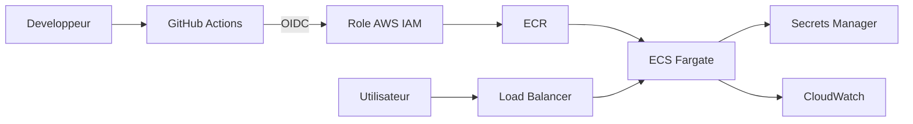

# devsecops-tp

[](https://github.com/Nolann-Mirotakaa/devsecops-tp/actions/workflows/ci.yml) [](https://github.com/Nolann-Mirotakaa/devsecops-tp/security/code-scanning)

Petite API Express durcie pour le TP CI/CD : tests, audit npm, analyse CodeQL, scan Docker et estimation des couts AWS. Aucune ressource AWS n'est creee.

## Lancer l'application

```bash
npm ci
npm test
npm audit --audit-level=high
npm start
```

L'API ecoute sur le port `3000` (modifiable avec `PORT`). Routes : `/health`, `/hello`, `/ping` et `/prefs`.

## Securite des secrets

Aucun vrai secret ne doit etre stocke dans le depot. `.env` est ignore par Git et `.env.example` ne contient que `PORT=3000`. Dans GitHub, activer Secret Protection et Push Protection et ajouter une capture d'ecran de ces reglages ici avant de rendre le TP.

Dependabot est configure pour `npm`, `github-actions` et `docker`. Les alertes Dependabot et mises a jour de securite doivent aussi etre activees dans les reglages du depot.

### Cle AWS poussee par erreur

Supprimer la cle dans un nouveau commit ne suffit pas : l'ancienne valeur reste dans l'historique Git. Il faut d'abord revoquer ou faire tourner la cle, puis verifier les journaux d'utilisation. Ensuite, supprimer la valeur de l'historique si necessaire, creer une nouvelle cle aux droits minimaux, la stocker dans un gestionnaire de secrets, et activer la detection et la protection contre les pushs de secrets. Une cle exposee est consideree compromise.

## Dependances

| Audit npm | Low | Moderate | High | Critical | Total |
| --- | ---: | ---: | ---: | ---: | ---: |
| Avant mise a jour | 7 | 16 | 5 | 0 | 28 |
| Apres mise a jour | 3 | 16 | 0 | 0 | 19 |

Le pipeline bloque les vuln?rabilites `high` et `critical`. Express est passe de `4.17.1` a `5.3.0`, Lodash de `4.17.15` a `4.18.1`. Les dependances restantes signalees par npm sont de niveau faible ou modere.

## Failles corrigees

| Route | Faille et exemple d'attaque | Correction |
| --- | --- | --- |
| `/hello` | XSS : `/hello?name=%3Cscript%3Ealert(1)%3C/script%3E` | Les caracteres HTML du nom sont echappes avant insertion dans la page. |
| `/ping` | Injection de commande : `/ping?host=127.0.0.1%3B%20echo%20injected` | Le nom d'hote est valide par une expression stricte et `execFile` passe les arguments sans shell. |
| `/prefs` | Pollution de prototype : `/prefs?constructor%5Bprototype%5D%5Badmin%5D=true` | Seules les cles `theme` et `lang` sont copiees depuis la requete. |

Les trois regressions ont un test dans `tests/security.test.js`. Les routes et les tests ne lancent aucune charge utile destructive.

## Pipeline

Le workflow CI ne se declenche que sur les pushs et pull requests vers `main`. Il lance les tests et `npm audit --audit-level=high`. CodeQL doit etre active avec la configuration par defaut du depot.

La branche `main` doit exiger une pull request et les controles `test`, `deps-audit` et CodeQL. Les jobs CI ont un delai maximal, utilisent `npm ci`, une permission minimale `contents: read` et annulent les executions remplacees.

## Image Docker

L'image de production est construite en deux etapes depuis `node:22-alpine` epingle par digest. L'etape de dependances fait `npm ci --omit=dev`; l'image finale ne contient que Node, les dependances de production et `src/`. Elle tourne avec l'utilisateur non-root `node`. Le contexte Docker ignore `.git`, `node_modules`, les tests et les fichiers `.env`.

| Image | Taille | Couches | CVE High | CVE Critical |
| --- | ---: | ---: | ---: | ---: |
| Naive (`node:22`, `COPY . .`, `npm install`) | 1,73 Go | 11 | 522 | 20 |
| Optimisee (multi-stage, Alpine, utilisateur `node`) | 251 Mo | 8 | 0 | 0 |

Mesures locales avec Docker et Trivy 0.74.0 le 4 novembre 2026. Le job CI scanne l'image optimisee et echoue sur les vulnerabilites `HIGH` ou `CRITICAL` corrigibles. Pour reproduire le lancement : `docker build -t devsecops-tp:optim .`, puis `docker run --rm -p 3000:3000 devsecops-tp:optim` et `curl http://localhost:3000/health`.

## Architecture cible et couts



Calcul pour une tache Fargate de `0,25 vCPU` et `0,5 Go`, prix fournis dans l'enonce (us-east-1, novembre 2026) :

| Scenario | Heures/mois | Calcul | Cout/mois |
| --- | ---: | --- | ---: |
| x86, 24 h/24 | 730 | `(0,25 x 0,04048 + 0,5 x 0,004445) x 730` | 9,01 $ |
| ARM, 24 h/24 | 730 | `(0,25 x 0,03238 + 0,5 x 0,003556) x 730` | 7,21 $ |
| x86, 12 h/jour x 5 jours/semaine | 260 | `(0,25 x 0,04048 + 0,5 x 0,004445) x 260` | 3,21 $ |

Une NAT Gateway a `0,045 $/h`, soit `32,85 $/mois` a 730 heures, sans trafic. C'est environ 3,65 fois le cout du scenario x86 24 h/24 (`9,01 $`). Le cout reseau depasserait donc celui de la tache seule ; il faut evaluer les endpoints VPC ou une architecture sans NAT avant de deployer.

La politique ECR qui conserve les dix images les plus recentes est dans [`aws/ecr-lifecycle.json`](aws/ecr-lifecycle.json). Ce TP ne cree aucune ressource AWS.

## Reponse sur le pinning Trivy

Oui : l'incident du 19 mars 2026 a redirige 76 tags sur 77, dont `v0.34.0` (les versions jusqu'a `v0.34.2`). Une execution qui utilisait ce tag pouvait donc lancer le code malveillant. Un SHA identifie un commit fixe et ne suit pas un changement de tag. Le workflow epingle `aquasecurity/trivy-action` par SHA, comme demande dans l'enonce. [Avis de securite officiel](https://github.com/aquasecurity/trivy/security/advisories/GHSA-69fq-xp46-6x23).
